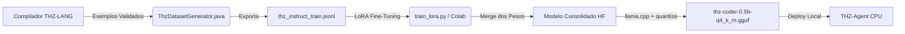

# Pipeline de Treinamento LoRA: THZ-CODER-0.5B

Este diretório contém as ferramentas e scripts para especialização nativa do modelo **THZ-CODER** (~0.5 bilhão de parâmetros) através de Low-Rank Adaptation (LoRA) e conversão para GGUF quantizado em `Q4_K_M`.

---

## 1. Passo a Passo do Pipeline



---

## 2. Passo 1: Exportar o Dataset de Treino

Execute na raiz do ecossistema:
```powershell
.\thz-agent.ps1 export-dataset
```
Ou dentro de `thz-agent-jvm`:
```powershell
.\gradlew.bat shadowJar
java -jar build/libs/thz-agent-0.5.0.jar export-dataset build/datasets/thz_instruct_train.jsonl
```

Isso gerará os pares instrução/resposta estruturados em ChatML (`messages: system, user, assistant`) cobrindo:
- Sintaxe Moderna Top-Level (`val`, `var`, `enquanto`, `para ... ate`, `para ... passo`)
- Sintaxe Foundational Corporativa (`PROGRAMA`, `PROCEDIMENTO`, `VARIAVEL`, `EXIBA`, `SOMAR A`)
- Compatibilidade e migração de COBOL (`SCREEN SECTION`, cores ANSI, divisions)
- Contratos de negócio (`EXIGE`, `GARANTE`)
- Minimal APIs e TUI de terminal

---

## 3. Passo 2: Treinamento Local (Com GPU NVIDIA)

### Pré-requisitos Python:
```bash
pip install torch transformers datasets peft trl bitsandbytes accelerate
```

### Executar o Treino e Merge:
```bash
python scripts/train_lora.py --dataset ../build/datasets/thz_instruct_train.jsonl
```

---

## 4. Passo 3: Treinamento Gratuito via Google Colab (Sem GPU Local)

Se você estiver em uma máquina sem GPU dedicada:
1. Abra um notebook no [Google Colab](https://colab.research.google.com/) com ambiente **T4 GPU** (gratuito).
2. Execute as seguintes células:

```python
# Célula 1: Instalação
!pip install -q torch transformers datasets peft trl bitsandbytes accelerate

# Célula 2: Upload do Dataset
from google.colab import files
uploaded = files.upload() # selecione thz_instruct_train.jsonl

# Célula 3: Treinamento LoRA
import torch
from datasets import load_dataset
from transformers import AutoModelForCausalLM, AutoTokenizer, TrainingArguments
from peft import LoraConfig, get_peft_model
from trl import SFTTrainer

base_model = "Qwen/Qwen2.5-Coder-0.5B-Instruct"
dataset = load_dataset("json", data_files="thz_instruct_train.jsonl", split="train")

tokenizer = AutoTokenizer.from_pretrained(base_model)
model = AutoModelForCausalLM.from_pretrained(base_model, torch_dtype=torch.float16, device_map="auto")

lora_config = LoraConfig(
    r=16,
    lora_alpha=32,
    target_modules=["q_proj", "k_proj", "v_proj", "o_proj", "gate_proj", "up_proj", "down_proj"],
    task_type="CAUSAL_LM"
)
model = get_peft_model(model, lora_config)

training_args = TrainingArguments(
    output_dir="./lora_out",
    num_train_epochs=3,
    per_device_train_batch_size=2,
    gradient_accumulation_steps=4,
    learning_rate=2e-4,
    fp16=True,
    logging_steps=5
)

trainer = SFTTrainer(model=model, train_dataset=dataset, args=training_args, peft_config=lora_config)
trainer.train()

# Célula 4: Merge dos Pesos
merged = model.merge_and_unload()
merged.save_pretrained("./thz_coder_merged")
tokenizer.save_pretrained("./thz_coder_merged")

# Célula 5: Converter para GGUF Q4_K_M
!git clone https://github.com/ggerganov/llama.cpp
!pip install -q -r llama.cpp/requirements.txt
!python llama.cpp/convert_hf_to_gguf.py ./thz_coder_merged --outfile thz-coder-0.5b-f16.gguf
!cd llama.cpp && cmake -B build && cmake --build build --config Release --target llama-quantize
!./llama.cpp/build/bin/llama-quantize ../thz-coder-0.5b-f16.gguf ../thz-coder-0.5b-q4_k_m.gguf Q4_K_M

files.download("thz-coder-0.5b-q4_k_m.gguf")
```

---

## 5. Passo 4: Instalar o Modelo no THZ-Agent

Após obter o arquivo `thz-coder-0.5b-q4_k_m.gguf`:
1. Copie para a pasta de modelos do THZ:
   - **Windows:** `%USERPROFILE%\.thz\models\thz-coder-0.5b-q4_k_m.gguf`
   - **Linux/macOS:** `~/.thz/models/thz-coder-0.5b-q4_k_m.gguf`
2. Inicie o agente apontando para ele:
   ```powershell
   .\thz-agent.ps1 --modelo thz-coder-0.5b-q4_k_m.gguf
   ```
O modelo responderá instantaneamente em THZ-LANG com zero alucinações e em CPU pura!
